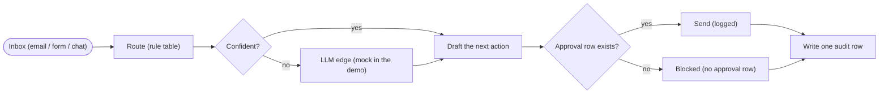

# Back-Office Triage — Route Inbound Messages, Draft the Action, Gate Every Send

**Platform:** AI Agent setup · **Category:** Back-office operations
**Outcome:** Every inbound email, web form and chat message is routed to one
queue, gets a drafted next action, and is **never sent until a human approves
it** — with one audit row per message so the whole day is reconstructable.

**Demand source:** `ai back office automation` (96 signals / 90 paid) and
`ai agent harness ops` (7 / 4) — ask [Back office automation expert needed](https://www.upwork.com/freelance-jobs/apply/automation-expert_~022105843885594892220/).

**Reader:** an ops manager drowning in inbound email/form/message triage who
wants the routing done before the morning stand-up but needs a hard gate so the
agent never sends on its own.

**Step graph** — the pipeline every inbound message goes through:

<!-- mermaid:start -->

<!-- mermaid:end -->

## The problem

A small ops team receives a flood of inbound mail, web forms and chat messages.
Every one needs the same manual pass: *who is this for, what is the next
action, and is it safe to let a machine answer?* Two things break. First, a
message that should reach billing gets answered by the support desk (or worse,
vice versa), and the customer feels the miss. Second — and this is the one that
keeps people up at night — the moment an assistant is allowed to "just reply",
there is no gate between *draft* and *send*: a refund offer, an order
cancellation or an account unlock goes out without a human signing it. And when
a week of triage turns into a disagreement, nobody can say what was routed,
where, or what was actually sent.

## The solution

One agent setup makes the deterministic parts of triage explicit and keeps the
human in the loop where it matters:

- **Route** — a declared rule table (`config/router.json`) scans the subject and
  body and picks the strongest queue match. When the strongest match is under
  the confidence threshold, the decision is handed to the **LLM edge** — a
  documented, prompted step that slots a live model in production and a
  deterministic stand-in in the demo.
- **Draft** — each queue has one template action (`config/router.json`), so a
  message never sits without a proposed next step. In the live lane the LLM
  phrases the draft from `prompts/draft.task.v1.txt`.
- **Gate — no send without an approval row.** This is structural, not a flag:
  the approval policy *requires* an approval source, and the release function
  (`bo_triage_audit.gate`) is the only place an action can be sent. A message
  with no approval row is **blocked** with a reason, every time.
- **Audit** — one audit row is written per routed message in the same run that
  routes it: queue, confidence, action, approval id or the block reason.
- **Mock lane** — `--mock-llm` runs the whole pipeline offline over the bundled
  fixture and fails the run if any output differs from `fixtures/expected/`.

The design point that makes this more than a prompt: **the core is
deterministic and the gate is enforced in code**, so the demo proves the
routing, the approvals discipline and the audit trail with no LLM key, no
mailbox and no network.

## Stack & credentials

| Stage | What runs it | Side effect |
| --- | --- | --- |
| Ingest | stdlib (`pathlib`) — header block + body | no |
| Route | rule table (`bo_triage_route`, `re`) | no |
| LLM edge (low confidence) | mock classifier in the demo; live model owner-side | no |
| Draft | queue templates (`bo_triage_draft`) | no |
| Approval gate | structural release check (`bo_triage_audit.gate`) | no |
| Audit + send log | stdlib (`csv`) | writes `routes.csv`, `audit.csv`, `sent.csv`, `blocked.csv` |

The shipped core needs **zero credentials and no third-party dependencies**. The
live lane a business hooks up is documented in [`.env.example`](.env.example):
an LLM endpoint that classifies low-confidence messages and phrases drafts, and
the inbox/ticket system the approved actions are sent to. Neither is needed for
the demo.

## Setup

Install once (or just run the file — the pack is dependency-free):

```bash
cd ai-agents/backoffice-triage
python3 -m pip install -e .        # provides the `bo-triage` command
```

Production run against a watched inbox folder:

```bash
cd ai-agents/backoffice-triage
bo-triage --route --inbox ./inbox --approvals ./approvals.csv
```

The approvals file is the business's own source of truth (a CSV today; a shared
sheet or ticket system is a drop-in owner-side swap). A message only ever sends
when its `source_file` names a row in that file — point `--route` at a folder
with no approvals file and it sends nothing. The mock lane below fixes the
approvals and the date so every demo run is identical.

## The credential-free mock lane

No install, no LLM key, no mailbox, no network — the bundled-fixture proof that
the pipeline works as declared:

```bash
cd ai-agents/backoffice-triage
python3 bo_triage_cli.py --mock-llm        # or: bo-triage --mock-llm
```

It processes `fixtures/inbox/` (10 messages: email, web forms and chat messages
covering all five queues, one deliberately ambiguous message that exercises the
LLM edge, and three pre-approved sends), writes `./mock-out/` (routes, audit,
sent, blocked), prints every route and gate outcome, and **fails the run** if
any output differs from `fixtures/expected/`.

## Verification

`bo-triage --mock-llm` output against the bundled fixtures:

| source_file | queue | conf | classifier |
| --- | --- | --- | --- |
| 01-email-refund-request.txt | billing | 0.95 | rules |
| 02-form-cancel-order.txt | shipping | 0.90 | rules |
| 03-email-tracking.txt | shipping | 0.90 | rules |
| 04-message-login-locked.txt | security | 0.95 | rules |
| 05-email-invoice-question.txt | billing | 0.90 | rules |
| 06-form-feedback.txt | support | 0.80 | rules |
| 07-email-ambiguous.txt | support | 0.90 | llm-mock |
| 08-message-password-reset.txt | security | 0.95 | rules |
| 09-email-vendor-confirmation.txt | shipping | 0.90 | rules |
| 10-form-complaint.txt | support | 0.85 | rules |

Message **07** has no billing/order/access keyword (“Please help — it's
urgent”): its strongest rule sits under the 0.75 threshold, so the LLM edge
resolves it to support at 0.90 — the one place the mock classifier stands in
for a live model.

The approval gate (`fixtures/expected/approvals.csv` approves exactly 03, 04,
09):

```
sent (3):
  03-email-tracking.txt            shipping  approval APR-1001
  04-message-login-locked.txt      security  approval APR-1002
  09-email-vendor-confirmation.txt shipping  approval APR-1003
blocked (7):                       (each: "no approval row")
digest: routed=10 sent=3 blocked=7 audit_rows=10 sensitive=4
RESULT: PASS - every output matches fixtures/expected/.
```

`audit.csv` holds exactly **10 rows — one per routed message**, each with its
queue, action, approval id or block reason. Re-running `--mock-llm` in the same
folder overwrites the same four files byte-for-byte — idempotency proved, not
claimed. `pytest`: **23 passed**.

CI-ready: the whole mock lane (this run, its idempotent re-run and the
no-approvals safety check) is asserted by one command —
`python3 -m pytest -q` in this folder. It is deterministic and offline, so the
published repo's CI job only has to call it.

## Reliability & error handling

- **The gate is structural.** `bo_triage_audit.gate()` is the only code path
  that releases a send; every other stage only drafts. A message with no
  approval row is blocked with the reason `no approval row`, and a run with no
  approvals file at all sends nothing (all 10 blocked in the fixture).
- **One audit row per message.** Routing, drafting and audit write happen in the
  same run, so the trail can never drift from the routing decision.
- **Deterministic core.** The rule table is pure regex over subject + body;
  ties are broken by rule order, so `config/router.json` fully explains every
  outcome. The mock LLM returns a confident decision for the same input every
  time — no randomness anywhere.
- **Versioned, self-describing config.** `config.json` and `router.json` carry a
  `version`; the loader refuses an unknown version and rejects a config that
  disables `require_approval`, so a future change cannot silently auto-send.
- **Header-block parsing.** Only the lines before the first blank line are
  headers, so a body line containing a colon is never mistaken for a field.
  Where no `Subject:` header exists the first body line stands in.
- **Sensitivity flags, never bypasses.** `billing` and `security` routes are
  flagged `sensitive` in the digest so the review queue sorts high-risk items
  first — but the flag never relaxes the gate.
- **Stable output.** The four CSV outputs are written with a fixed header and
  stable (sorted) row order, so CI can assert them byte-for-byte.

## Results & impact

**Evidence (repo-verifiable):**

| What | Result |
| --- | --- |
| `bo-triage --mock-llm` | PASS — routes, audit, sent and blocked all match `fixtures/expected/` |
| Approval gate | 3 sent (03, 04, 09) are exactly the 3 with approval rows; the other 7 are blocked |
| Audit trail | 10 rows, one per routed message |
| LLM edge | Message 07 resolved via the mock LLM (0.90, llm-mock) |
| `pytest` | 23 passed |
| Credentials / network needed | 0 |

**Business outcome (owner-supplied):**

<!-- owner-metric: minutes of triage saved per day, or mis-routed / unauthorised sends per month before vs after -->

## The honest limit

The router is a **static keyword rule table** — it generalizes the bundled
fixture, not natural-language nuance. A message written entirely in jargon, a
free-text complaint that mentions no trigger word, or a language the rules do
not cover routes to `general` (the default) rather than to a wrong queue, and
the LLM edge — a deterministic stand-in in the demo — is where a live model
slots in for real-world phrasing (`prompts/classify.task.v1.txt`). The fixture
is 10 synthetic messages; real inboxes are messier, and the approval source is a
CSV the business owns — wiring it to a shared sheet or a ticket system is an
owner-side step. Sending itself is a logged CSV row in this pack; connecting
`sent.csv` to the real mailbox or ticketing endpoint is the documented
integration point, and it stays behind the same approval gate.

## Sanitization notes

This artifact is authored content. All fixtures are synthetic: customers,
orders, invoices and amounts are invented, every address uses the reserved
`*.example` domain, and no real customer or business data ships. The
`.env.example` holds placeholder keys only — no credentials. The versioned
prompts are templates, not customer content.

---

*Need something like this for your business?
[Contact me](../../README.md#hire-me)*