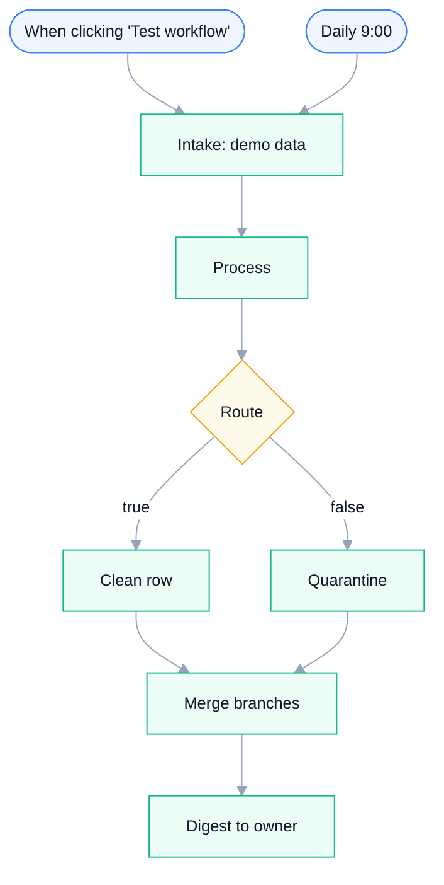

# CSV Cleaner — Validate, Dedupe & Quarantine a Messy Batch

**Platform:** n8n · **Category:** Data / Spreadsheet Ops
**Outcome:** Every row in a batch is checked — clean rows flow forward, the
rest land in a reason-coded quarantine, and you get exactly one summary per
run so nothing drops silently.

**Demand source:** `manual data entry burden` (262 signals / 251 paid) and
`spreadsheet data to form autofill` (20 / 18) —
[freelancer.com project 40755642](https://www.freelancer.com/projects/ai-hw-sw/automate-mail-processing-with-cronoscan-40755642).

*Architecture diagram — source [`assets/diagram.json`](assets/diagram.json),
rendered with [archify](https://github.com/tt-a1i/archify)*

**Node graph** — generated from `workflow.json` (see
`scripts/render-mermaid.py`; regenerate after changing the workflow):

<!-- mermaid:start -->

<!-- mermaid:end -->

## The problem

Anyone who has imported a CSV from a form export, a supplier, or a scraper
knows the routine: blank names, malformed emails, the same address twice.
Filtering it by hand is slow, and the usual spreadsheet formula silently
drops the bad rows — so the errors only surface downstream, after the import
that trusted them.

## The solution

A single n8n workflow validates an incoming batch and makes the failure path
a first-class output rather than a silent drop:

- **Intake** loads the batch (a demo batch of six rows ships in the export).
- **Process** checks each row in one pass — email format, a missing name, and
  a duplicate-address check against a per-run `seen` set — and tags the row
  with an `ok` flag and a reason.
- **Route** splits on that flag: accepted rows take the **Clean row** branch,
  everything else takes **Quarantine**, which stamps the exact reason
  (`invalid email`, `missing name`, `duplicate email`).
- **Merge branches** joins both branches so **Digest to owner** fires exactly
  once per run and prints `N cleaned / M alerts` plus a per-alert detail line.

The design point that makes this more than a filter formula: the quarantine
branch, the reason codes, and the single merged digest are all explicit nodes
in the graph — you can see and extend each one, and nothing leaves the batch
unaccounted for.

## Stack & credentials

13 nodes — Manual Trigger, Schedule Trigger, Code, IF, Merge, Sticky Notes.
**Zero credentials required** — no node makes an external call, and the demo
intake emits six sample rows covering every branch (bad email, duplicate
address, missing name, plus clean rows). `.env.example` exists only to
complete the folder contract; there is nothing to fill in.

## Setup

~2 minutes. Import `workflow.json`, click **Test workflow** — the demo runs
end-to-end on import.

**To go live:** swap the demo intake for a real source (n8n Form Trigger, a
file read, or a Google Sheets node) emitting the same row shape — see
[`examples/csv-cleaner/`](../../examples/csv-cleaner/). Replace the two Code
outputs with real write/alert nodes (a Sheets append for clean rows, a
Gmail/Slack node for quarantine). The `Daily 9:00` schedule trigger is the
production shape; it stays inert until you activate the workflow.

## Customize

All validation lives in the **Process** Code node — no other node needs
touching:

- the email regex — tighten or relax the format the batch must match;
- the duplicate key — the `seen` set keys on `email`; change it to any single
  field or a composite (`email + date`) to redefine "duplicate";
- the reason strings — the quarantine `reason` values are plain text, easy to
  map onto your own error vocabulary.

## Verification

Verified in a clean n8n container: the export imports with zero credentials
attached and the demo batch runs every branch in one pass.

### Run it yourself

The bundled demo batch is the fastest way to see it run — click **Test
workflow** after import. The documented row contract and the expected verdict
per sample live in
[`examples/csv-cleaner/`](../../examples/csv-cleaner/)
([`test-data.json`](../../examples/csv-cleaner/test-data.json)).

## Reliability & error handling

This workflow makes **no external calls at all** — every node is Code, IF,
Merge, a Trigger or a Sticky Note — so there is nothing to retry, no
credential to expire and no network failure surface. The mechanisms that
exist are deterministic in-run logic:

- **Dedupe by email, per run** — **Process** keeps a `seen` set for the run;
  a repeat address is quarantined as `duplicate email` instead of being
  processed twice (in-run idempotency).
- **Quarantine instead of a silent drop** — **Route** sends every failed row
  to **Quarantine**, which emits a reason-coded alert. The failure path is a
  real branch with its own output, not a dropped item.
- **Exactly one digest per run** — **Merge branches** joins both branches
  before **Digest to owner**, so the owner summary fires once per run, not
  once per branch or per item.
- **Deterministic verdicts** — validation is pure string logic on each row:
  same input, same verdict, every run.

## Results & impact

**Evidence (repo-verifiable):**

| What | Result |
|---|---|
| Import with a clean n8n container | Clean, zero credentials attached |
| Demo batch | 6 sample rows emitted by the `Intake: demo data` Code node |
| Edge cases exercised in one run | 3 — invalid email, duplicate address, missing name |
| Demo-run outcome | 3 cleaned rows, 3 reason-coded alerts, exactly 1 owner digest |
| Credentialed nodes | 0 of 13 — runs end-to-end with no setup |

**Business outcome (owner-supplied):**

<!-- owner-metric: rows cleaned per month, or hours saved vs manual filtering -->

## The honest limit

Absent by design, stated honestly: no `retryOnFail`/`maxTries` (nothing to
retry), no Error Trigger / error workflow, and no live-vs-demo gate — there
are no live nodes; the demo intake is itself a Code node. Any runtime error
surfaces in n8n's execution list.

## Sanitization notes

Sanitized for public sharing: the instance identifier and the workflow
`id` were stripped from the export before publishing. The workflow has never
contained credentials, pinned data or webhook IDs — it makes no external
calls and has no webhook nodes — so what remains is the complete node graph,
connections and settings, importable as-is.

---

*Need something like this for your business?
[Contact me](../../README.md#hire-me)*
