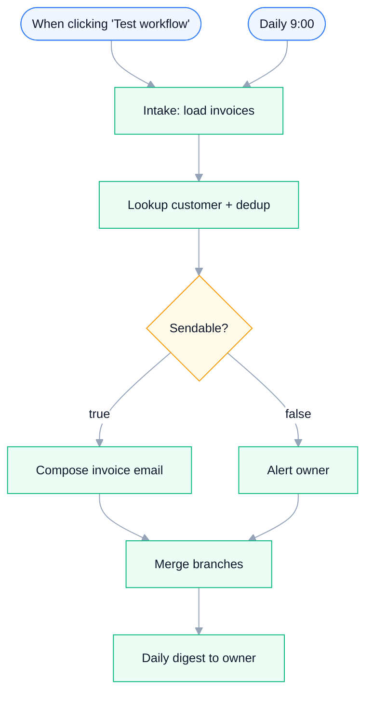

# Invoice Emailer — Compose, Send & Alert the Owner on Failures

**Platform:** n8n · **Category:** Invoicing & Billing
**Outcome:** Every invoice in a batch is matched to a customer and deduped — the
clean ones become send-ready email payloads, the rest land in a reason-coded
owner alert, and the run ends with exactly one digest so nothing goes out twice
or disappears.

**Demand source:** `invoice delivery and emailing` (8 signals / 2 paid) and
`marketplace orders to invoice automation` (3 / 2) —
[r/smallbusiness "How do you all handle invoicing?"](https://www.reddit.com/r/smallbusiness/comments/1tcaizi/how_do_you_all_handle_invoicing_im_embarrassed_by/).

*Architecture diagram — source [`assets/diagram.json`](assets/diagram.json),
rendered with [archify](https://github.com/tt-a1i/archify)*

**Node graph** — generated from `workflow.json` (see
`scripts/render-mermaid.py`; regenerate after changing the workflow):

<!-- mermaid:start -->

<!-- mermaid:end -->

## The problem

Freelancers and small-business owners who email invoices do it by hand: open
the folder (or the sales export), pick the next invoice, look up who it is for,
attach the PDF, send. It works — until it doesn't. A batch read twice sends a
customer the same invoice twice; an invoice with no matching customer record
never goes out at all, and nothing tells you. The failure mode is silence, and
silence in invoicing means an unpaid invoice you find weeks later.

## The solution

A single n8n workflow turns an invoice batch into send-ready emails while
making the failure path a first-class output rather than a silent drop:

- **Intake: load invoices** loads the batch — a demo batch of four invoices
  ships in the export, including one unknown customer and one duplicate.
- **Lookup customer + dedup** matches each invoice to a customer record and
  keeps a per-run `seen` set of invoice numbers, so a repeat is flagged instead
  of being sent again. Every row leaves tagged `sendable` with the reason.
- **Sendable?** splits on that flag: sendable rows take **Compose invoice
  email**, which builds the `to / subject / body / attachment` payload;
  everything else takes **Alert owner**, which stamps the exact reason
  (`duplicate of INV-… — already processed`, `no customer record for key '…'`).
- **Merge branches** joins both branches so **Daily digest to owner** fires
  exactly once per run and prints `N composed / M alert(s)` plus a per-alert
  detail line.

The design point that makes this more than a mail-merge script: the compose
node stops at a **send-ready payload** (one node swap from a real Gmail / Send
Email node), the dedup and the owner alert are explicit nodes in the graph, and
nothing leaves the batch unaccounted for.

## Stack & credentials

16 nodes — Manual Trigger, Schedule Trigger, Code, IF, Merge, Sticky Notes.
**Zero credentials required** — no node makes an external call, and the demo
intake emits four sample invoices covering every branch (unknown customer,
duplicate, plus clean rows). `.env.example` exists only to complete the folder
contract; there is nothing to fill in.

## Setup

~2 minutes. Import `workflow.json`, click **Test workflow** — the demo runs
end-to-end on import.

**To go live:** swap the demo intake for a real source (a folder watch, an
email-inbox trigger, or a Google Sheets read) emitting the same row shape — see
[`examples/invoice-emailer/`](../../examples/invoice-emailer/). Replace the
inline customer map in **Lookup customer + dedup** with your Sheets/Airtable
read, add a Gmail / Send Email node after **Compose invoice email** and map
`to / subject / body / attachment` (the payload already matches), and point
**Alert owner** at Slack or email. The `Daily 9:00` schedule trigger is the
production shape; it stays inert until you activate the workflow.

## Customize

All matching and dedup logic lives in the **Lookup customer + dedup** Code
node — no other node needs touching:

- the customer source — replace the inline `customers` map with a Sheet/DB
  read; keep the `{ name, email }` shape;
- the dedup key — the `seen` set keys on `invoice_no`; change it to any field
  or a composite to redefine "duplicate";
- the send payload — the `to / subject / body / attachment` fields are plain
  text, easy to map onto your own template or CRM.

## Verification

Verified in a clean n8n container: the export imports with zero credentials
attached and the demo batch runs both branches in one pass.

### Run it yourself

The bundled demo batch is the fastest way to see it run — click **Test
workflow** after import. The documented row contract and the expected verdict
per sample live in
[`examples/invoice-emailer/`](../../examples/invoice-emailer/)
([`test-data.json`](../../examples/invoice-emailer/test-data.json)).

## Reliability & error handling

This workflow makes **no external calls at all** — every node is Code, IF,
Merge, a Trigger or a Sticky Note — so there is nothing to retry, no credential
to expire and no network failure surface. The mechanisms that exist are
deterministic in-run logic:

- **Dedupe by invoice number, per run** — **Lookup customer + dedup** keeps a
  `seen` set for the run; a repeat invoice is flagged `duplicate` instead of
  being sent again (in-run idempotency).
- **Alert instead of a silent skip** — **Sendable?** sends every unsendable
  row to **Alert owner**, which emits a reason-coded alert. The failure path is
  a real branch with its own output, not a dropped item.
- **Exactly one digest per run** — **Merge branches** joins both branches
  before **Daily digest to owner**, so the owner summary fires once per run,
  not once per branch or per item.
- **Deterministic verdicts** — matching and dedup are pure in-memory lookups
  on each row: same input, same verdict, every run.

## Results & impact

**Evidence (repo-verifiable):**

| What | Result |
|---|---|
| Import with a clean n8n container | Clean, zero credentials attached |
| Demo batch | 4 sample invoices emitted by the `Intake: load invoices` Code node |
| Edge cases exercised in one run | 2 — unknown customer key, duplicate invoice number |
| Demo-run outcome | 2 composed payloads, 2 reason-coded alerts, exactly 1 owner digest |
| Credentialed nodes | 0 of 16 — runs end-to-end with no setup |

**Business outcome (owner-supplied):**

<!-- owner-metric: invoices sent per month, or hours saved vs manual sending -->

## The honest limit

Absent by design, stated honestly: no `retryOnFail`/`maxTries` (nothing to
retry), no Error Trigger / error workflow, and no live-vs-demo gate — there are
no live nodes; the demo intake is itself a Code node. Any runtime error
surfaces in n8n's execution list.

## Sanitization notes

Sanitized for public sharing: the instance identifier and the workflow `id`
were stripped, and the export's pinned data (`pinData`) removed, before
publishing. The export's `staticData` was already `null` — no stored run
state — and is left as-is. The workflow has never contained credentials or
webhook IDs — it makes no external calls and has no webhook nodes — so what
remains is the complete node graph, connections and settings, importable
as-is.

---

*Need something like this for your business?
[Contact me](../../README.md#hire-me)*
