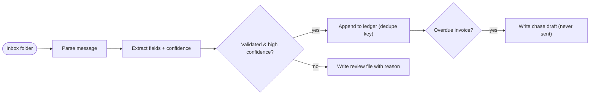

# Invoice Ledger — Parse Invoices & Receipts into a Bookkeeping-Ready Ledger

**Platform:** Python CLI · **Category:** Bookkeeping & Finance
**Outcome:** Every invoice and receipt that lands in a watched folder is parsed,
validated and appended once to a bookkeeping-ready CSV ledger; anything the
deterministic extractor is not sure about goes to a review file with its
reason, and overdue invoices get a draft chase that is never sent on its own.

**Demand source:** `invoice delivery and emailing` (8 signals / 2 paid),
`double-entry bookkeeping outsourcing` (29 / 25) and `manual data entry burden`
(262 / 251) — ask [How do you all handle invoicing?](https://www.reddit.com/r/smallbusiness/comments/1tcaizi/how_do_you_all_handle_invoicing_im_embarrassed_by/).

**Reader:** a small-business owner or part-time accountant who receives
invoices and receipts by email and keys them into a sheet by hand.

**Step graph** — the pipeline every inbox file goes through:

<!-- mermaid:start -->

<!-- mermaid:end -->

## The problem

A small business receives invoices and receipts scattered across email and
paper, and the bookkeeping is a nightly keying session: find the amount, guess
the currency, type it into the sheet. Two things break. The same invoice comes
twice (a sender reminder, a forwarded copy) and gets entered twice. And an
invoice with no number — or a PDF that won't OCR cleanly — sits in the inbox
with nothing flagging it, so the ledger silently undercounts. The failure is
invisible until the accountant asks where the money went.

## The solution

One CLI makes the deterministic parts of that job explicit and repeatable:

- **Parse** — each plain-text message is split into header and body; the body's
  `label: value` lines are read (invoice/receipt number, dates, amount,
  currency, vendor).
- **Extract + score** — the extractor is a declared rule table, not a model: an
  item is **high** confidence only when vendor, number, date and amount are all
  present and well-formed. Anything else is **low** with the exact reasons.
- **Validate** — business rules (reference format, vendor length, an amount
  sanity cap) catch well-formed-but-wrong rows before they post.
- **Append once** — the ledger is keyed by a dedupe key derived from the
  document itself, so the same invoice is never written twice — in one batch or
  across re-runs.
- **Quarantine** — low-confidence items never reach the ledger; they land in a
  `review.csv` with their reasons, ready for a human to adjudicate.
- **Draft the chase** — an invoice whose due date is before `--as-of` gets a
  payment-chase draft written to disk. A draft, never a send.

The design point that makes this more than a scrape: **the ledger write is
idempotent and the whole core is deterministic**, so the same inbox can be
reprocessed endlessly, and the demo lane proves the pipeline on bundled
fixtures with no mailbox, no LLM and no network.

## Stack & credentials

| Stage | What runs it | Side effect |
| --- | --- | --- |
| Inbox folder read | stdlib (`pathlib`) | no |
| Parse | stdlib (`re`, `dataclasses`) | no |
| Extract + confidence | stdlib rule table (`invoice_ledger_extract`) | no |
| Validate | stdlib rules (`invoice_ledger_validate`) | no |
| Ledger append | stdlib (`csv`) — dedupe-keyed, idempotent | writes `ledger.csv` |
| Review file | stdlib (`csv`) | writes `review.csv` |
| Chase draft | stdlib (`pathlib`) | writes `drafts/chase-*.txt` |

The shipped core needs **zero credentials and no third-party dependencies** —
everything runs on the Python standard library. The live lane a business hooks
up is owner-side and documented in [`.env.example`](.env.example): a mailbox
watch (IMAP) or mail-to-folder bridge that drops messages into the inbox
folder, and optionally an LLM summariser for ambiguous documents before a human
posts them (the `LLM_API_KEY` placeholders). Neither is needed for the demo.

## Setup

Install once (or just run the file — the pack is dependency-free):

```bash
cd python/invoice-ledger
python3 -m pip install -e .        # provides the `invoice-ledger` command
```

Production run against a watched folder:

```bash
invoice-ledger --inbox ./inbox --ledger ./ledger.csv --review ./review.csv
```

`--as-of YYYY-MM-DD` sets the date the overdue check judges against (it
defaults to today for production runs). The demo lane below fixes it so every
demo run is identical.

## The credential-free demo lane

No install, no mailbox, no network — the bundled-fixture proof that the pipeline
works as declared:

```bash
cd python/invoice-ledger
python3 invoice_ledger_cli.py --demo        # or: invoice-ledger --demo
```

It processes `fixtures/inbox/` (9 messages: clean invoices and receipts,
in-batch duplicates, and the three failure modes) against the fixed
`as-of 2026-09-30`, writes `./demo-out/` (ledger, review, draft), prints every
verdict, and **fails the run** if the emitted ledger differs from
`fixtures/expected/ledger.csv`.

## Verification

`invoice-ledger --demo` output against the bundled fixtures:

| File | Verdict | Detail |
| --- | --- | --- |
| 01-invoice-acme.txt | posted | ledger row, chase drafted (due 2026-08-31 < as-of) |
| 02-receipt-globex.txt | posted | ledger row |
| 03-invoice-acme-duplicate.txt | skipped | duplicate of `acme facilities co\|INV-1001` |
| 04-receipt-globex-duplicate.txt | skipped | duplicate of `globex corp\|RCT-2001` |
| 05-invoice-no-number.txt | reviewed | `missing invoice number` |
| 06-receipt-bad-amount.txt | reviewed | `amount not parseable` |
| 07-invoice-bad-date.txt | reviewed | `issue date not parseable` |
| 08-invoice-umbrella.txt | posted | ledger row (due 2026-10-05 ≥ as-of, no draft) |
| 09-receipt-initech.txt | posted | ledger row, EUR |

Emitted ledger (`fixtures/expected/ledger.csv`, 4 rows — the exact expected
ledger):

| issue_date | kind | vendor | reference | amount | currency | source |
| --- | --- | --- | --- | --- | --- | --- |
| 2026-08-01 | invoice | ACME Facilities Co | INV-1001 | 1250.00 | USD | 01-invoice-acme.txt |
| 2026-09-12 | receipt | GLOBEX Corp | RCT-2001 | 86.40 | USD | 02-receipt-globex.txt |
| 2026-09-15 | invoice | Umbrella Corp | INV-1002 | 4800.00 | USD | 08-invoice-umbrella.txt |
| 2026-09-20 | receipt | Initech Services | RCT-2002 | 120.00 | EUR | 09-receipt-initech.txt |

```
digest: posted=4 skipped=2 reviewed=3 drafts=1 ledger_rows=4
RESULT: PASS - the demo ledger exactly matches fixtures/expected/ledger.csv.
```

Re-running `--demo` in the same folder changes nothing: the 4 posted keys are
already in the ledger, so the row count stays 4 — idempotency proved, not
claimed. `pytest`: **23 passed**.

## Reliability & error handling

- **Idempotent by dedupe key.** A row only posts if its key
  (`vendor|reference`, or `vendor|date|amount|currency` for number-less
  receipts) is unseen. Duplicates inside one batch and across re-runs are both
  skipped, never re-written — the row count is unchanged on the second run.
- **Low-confidence quarantine.** Any missing field, unparseable amount/date or
  failed business rule sends the item to `review.csv` with its ordered reasons.
  A human adjudicates; the ledger never carries a guessed value.
- **Deterministic core.** The extractor's confidence rule table and the
  validator are pure functions — the same text always decides the same way, in
  the demo and in production. The demo needs no LLM and no network.
- **Currency guard.** An unlabelled amount defaults to USD but an explicitly
  unrecognised currency is flagged rather than silently posted.
- **Chase drafts are drafts.** `drafts/chase-*.txt` is written to disk, never
  emailed; the template names the invoice, amount, due date and the `as-of`
  date it was judged against.
- **Stable output.** The ledger is written sorted by issue date then key, so a
  diff against the expected file is meaningful and CI can assert it.

## Results & impact

**Evidence (repo-verifiable):**

| What | Result |
| --- | --- |
| `invoice-ledger --demo` | PASS — ledger exactly matches `fixtures/expected/ledger.csv` |
| Idempotency | Re-run in the same folder leaves the row count unchanged (4) |
| Review quarantine | 3 items written with reasons (missing number / amount / date) |
| Chase drafts | Exactly 1 (`chase-INV-1001.txt`), never sent |
| `pytest` | 23 passed |
| Credentials / network needed | 0 |

**Business outcome (owner-supplied):**

<!-- owner-metric: minutes saved per week vs manual entry, or receipts mis-entered per month before vs after -->

## The honest limit

The shipped core reads **plain-text messages in the input contract shown in
[`examples/invoice-ledger/`](../../examples/invoice-ledger/)** — header block,
blank line, `label: value` body. It does not read PDFs or scanned images;
turning those into text is an owner-side step (OCR or the mail tool's own
extraction) before a file lands in the inbox. Amounts use `1,250.00` /
`€120.00` formatting; the European `1 250,00` style is deliberately rejected to
`review` rather than misread. The live mailbox and LLM steps are documented
owner-side integrations — the demo lane proves the deterministic core, and it
runs with no account and no network.

## Sanitization notes

This artifact is authored content. All fixtures are synthetic: vendors and
amounts are invented, every address uses the reserved `*.example` domain, and
no real customer, billing or payment data ships. The `.env.example` holds
placeholder keys only — no credentials. The chase template mentions the sample
vendor "ACME Facilities Co" and sample invoice `INV-1001`, both fabricated.

---

*Need something like this for your business?
[Contact me](../../README.md#hire-me)*