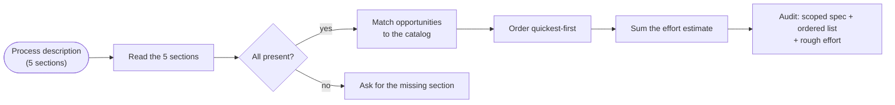

# Automation Audit — A Described Process In, a Scoped Spec and a Ranked Build List Out

**Platform:** Skills · **Category:** Scoping & proposal
**Outcome:** Paste a described business process and get back a scoped spec, an
ordered automation list (quickest win first) and a rough effort estimate —
the same structure an agency returns after a paid discovery call, produced
from a written description with no model, no key and no network.

**Demand source:** `ongoing n8n make automation specialist` (21 / 21) — ask
[Looking for n8n / Make automation specialist for ongoing fixed-price projects](https://community.n8n.io/t/looking-for-n8n-make-automation-specialist-for-ongoing-fixed-price-projects/315672)
(n8n Community "Jobs", posted 2026-09-22).

**Reader:** a founder or ops lead who describes a manual process on a call or
in a message ("we key invoices into a sheet by hand") and wants something
concrete back — what is worth automating first, what the scope is, roughly
what it takes — before any build commitment.

**Step graph** — the pipeline every process description goes through:

<!-- mermaid:start -->

<!-- mermaid:end -->

## The problem

Scoping is where automation work gets stuck. A founder describes a process in
their own words ("invoices arrive by email and someone keys them in by hand"),
and the honest next step is a structured answer — what exactly is in scope,
which automation is worth building first, roughly how long it takes. Without
structure, that answer is a guess that drifts: the scope quietly expands in
the quote, the "quick win" is the one nobody ordered first, and the effort
estimate is plucked from the air. And a business process that *cannot* be
scoped this way is itself a signal — the description is missing the five
sections a good brief must carry.

## The solution

One skill makes the audit structure explicit and the numbers honest:

- **A described process in** — five required sections (`Business problem`,
  `In scope`, `Out of scope`, `Success signal`, `Automation opportunities`).
  No section, no audit: the skill stops and asks rather than guess.
- **A scoped spec out** — the first four sections, echoed in the owner's own
  words, with the success signal that says the automation worked.
- **An ordered automation list** — every opportunity matched to an effort
  catalog (13 pillars from invoice capture to handover packs) and ordered
  quickest-first. Candidates that match nothing are marked `effort TBD
  (scope first)`, never estimated by hand.
- **A rough effort estimate** — the sum of matched catalog efforts, explicitly
  labeled *catalog estimates*, the rough bucket a scoped quote is checked
  against — never a quote and never a figure lifted from the description.
- **A credential-free lane** — `audit_lane.py` reproduces all of it
  deterministically over bundled fixtures and fails if any output drifts.

The design point that makes this a lead magnet: **the demo needs no LLM key,
no model and no network**. The skill works live with an agent's judgement on
top; the lane is the offline proof that the structure holds, byte-for-byte,
every run.

## Stack & credentials

| Stage | What runs it | Side effect |
| --- | --- | --- |
| Read sections | stdlib (`re`, `pathlib`) — heading parser | no |
| Match to catalog | `audit_lane.match_pillar` (longest-keyword, deterministic) | no |
| Order + estimate | pure functions over `audit_lane.CATALOG` | no |
| Self-check | `audit_lane.self_check` — compares to `fixtures/expected/` | no |

The shipped artifact needs **zero credentials, no third-party dependencies
and no network**. The live lane is the same four stages run with judgement
(the skill itself is `SKILL.md`); the pack only adds a deterministic spine so
the claim "every required section, every run" is provable, not asserted.

## Setup

No install is needed to run the lane — it is dependency-free:

```bash
cd skills/automation-audit
python3 audit_lane.py --audit fixtures/processes/01-invoice-emailing.md
```

Install once if you want the pack importable as a module (used by the tests):

```bash
cd skills/automation-audit
python3 -m pip install -e .
```

## The credential-free audit lane

No install, no LLM key, no network — the bundled-fixture proof that the skill
produces every required section:

```bash
cd skills/automation-audit
python3 audit_lane.py --self-check
```

It processes every `fixtures/processes/*.md` (the two fixture process
descriptions plus the worked example built from a real ask), renders the
audit for each, and **fails the run** if any output differs from
`fixtures/expected/` or is not reproducible on a second run.

## Verification

Audit results against the bundled fixtures:

| Fixture | Candidates (ordered) | Effort total |
| --- | --- | --- |
| 01-invoice-emailing | Attachment filing (S, ~3h) → Invoice & receipt capture (S, ~4h) | ~7h |
| 02-lead-intake | Approval-gated drafts (S, ~6h) → Lead intake & follow-up (M, ~8h) | ~14h |
| 03-fixed-price-service (worked example) | Milestone acceptance tracking (S, ~3h) → Client-brief intake (S, ~4h) → Handover-pack generation (S, ~5h) | ~12h |

Every audit carries the six required sections — `Business problem`, `Scope
in`, `Scope out`, `Success signal`, `Automation candidates (ordered)`,
`Rough effort estimate` — asserted per fixture in the test suite.

`--self-check` (three fixtures) → `RESULT: PASS`. `pytest`: **9 passed, 1 skipped**.
mypy, ruff and the repository's own `verify_skill_format` validator all pass
on the pack.

CI-ready: the whole lane is asserted by one command —
`python3 -m pytest -q` in this folder. It is deterministic and offline, so
the published repo's CI job only has to call it.

## Worked example (real ask)

`fixtures/processes/03-fixed-price-service.md` is built from a **real
source** — the n8n Community "Jobs" thread
[Looking for n8n / Make automation specialist for ongoing fixed-price projects](https://community.n8n.io/t/looking-for-n8n-make-automation-specialist-for-ongoing-fixed-price-projects/315672)
(posted 2026-09-22). The auditor's own words only frame the process; the
quoted lines are the poster's verbatim text:

> "I'm building a small automation service and I'm looking for reliable n8n /
> Make specialists for ongoing project-based work."
>
> "I'm looking for people who can work on clearly defined fixed-price
> projects with agreed deadlines."
>
> "Payment would be agreed per project or milestone and paid after the
> corresponding client milestone is approved and funds are released."

**Numbers provenance — nothing in this example is invented:**

| Number in the example | Origin |
| --- | --- |
| Milestone ~3h, brief ~4h, handover ~5h | Skill's own effort catalog (`audit_lane.CATALOG`) |
| Total ~12h | Sum of the catalog figures above |
| The ask's price context | Not used — the ask states none of its own figures, so none are quoted as source numbers |

The audit links every hour figure to the catalog in one file, and the
test suite fails if any number in the generated sections comes from outside
that closed set.

## Reliability & error handling

- **The five-section contract is enforced.** A description missing `Out of
  scope` (for example) is refused with the missing section named — the audit
  never silently guesses.
- **Longest-keyword matching, deterministic ties.** Candidate → pillar
  matching picks the longest catalog keyword present; equal-length matches
  resolve to catalog order, so the same description always gives the same
  list.
- **Unmapped candidates are never estimated.** A candidate that matches no
  catalog pillar gets `effort TBD (scope first)` and is excluded from the
  total — the audit says "needs a scoped quote" instead of inventing hours.
- **Echo, don't paraphrase the owner's words.** The scoped spec quotes the
  description's own sections, so the audit cannot drift from what the owner
  actually said.
- **Estimates are labeled, not disguised.** Every hour figure is a catalog
  estimate; the worked example documents where each number comes from.
- **Reproducible lane.** `--self-check` runs each fixture twice and compares
  byte-for-byte against `fixtures/expected/` — determinism is proved, not
  claimed, and cwd-independent (paths resolve from the module).

## Results & impact

**Evidence (repo-verifiable):**

| What | Result |
| --- | --- |
| `audit_lane.py --self-check` | RESULT: PASS — 3 fixture audits match `fixtures/expected/`, reproducible |
| Required sections per fixture | All 6 present in 01 and 02 (and 03) |
| Worked example source | Real ask cited (thread 315672); no invented numbers (generated figures ⊆ catalog ∪ total) |
| `pytest` | 9 passed, 1 skipped |
| Validator / lint / types | `verify_skill_format` PASS · ruff clean · mypy Success |
| Credentials / network needed | 0 |

**Business outcome (owner-supplied):**

<!-- owner-metric: free audits delivered per month, or leads that convert after receiving a scoped-spec + ordered-list + effort audit -->

## The honest limit

The effort catalog is a **fixed table of rough buckets** — it sorts candidates
quickest-first and sums honest planning numbers, but it does not replace a
scoped quote. Real effort depends on the integrations, the data quality and
the error paths a specific business carries, which is exactly why the skill
labels every figure a *catalog estimate* and why unmapped candidates come
back as *scope first*. The lane is deterministic proof of the *structure*,
not a substitute for build-time scoping. The two fixture processes are
synthetic; the worked example is one real hiring brief, quoted verbatim and
audited — one example is not a market sample.

## Sanitization notes

This artifact is authored content. The two fixture process descriptions are
synthetic; the worked example quotes a public n8n Community post and cites its
URL. No customer, business or financial data ships, no credentials of any
kind are used, and no number is presented as a source figure unless it is a
verbatim quote of the cited post.

---

*Need something like this for your business?
[Contact me](../../README.md#hire-me)*