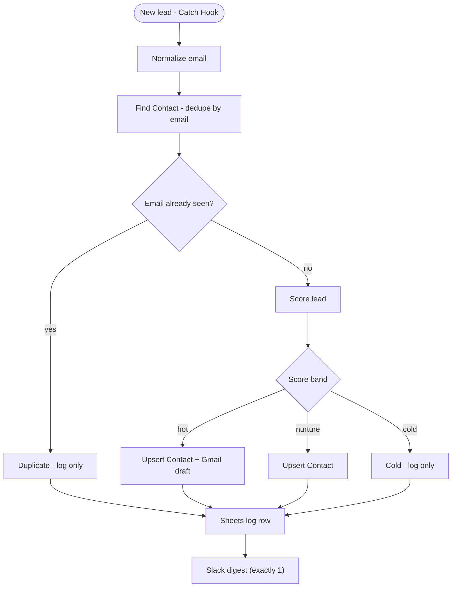

# Lead Router — Score, Dedupe & Route Form/Email Leads into Close

**Platform:** Zapier · **Category:** Sales & CRM
**Outcome:** Every form and inbox lead is normalized, deduped and scored by a
declared rule table, then routed — hot leads get a CRM upsert and a
review-gated draft, the rest are logged with the reason — and the run ends
with exactly one digest, so no lead is written twice or lost silently.

**Demand source:** `b2b lead list building` (82 signals / 80 paid) and
`crm setup and migration` (51 / 51) — ask
[Zapier Automations and Close CRM](https://upwork.com/freelance-jobs/apply/Zapier-Automations-and-Close-CRM_~022104996531857444489).

**Reader:** an SMB or agency already on Zapier (post price-hike) whose website
form and inbox leads leak between tools and the CRM.

**Step graph** — hand-drawn from [`spec.json`](spec.json):

<!-- mermaid:start -->

<!-- mermaid:end -->

## The problem

A small team catches leads in three places — a website form, a landing page and
a shared inbox — and none of them talk to the CRM. Someone copies each lead
across by hand: check whether the person is already a contact, guess whether the
lead is worth a follow-up, paste it in, write the reply. Two things break every
week. A re-submitted form creates a second contact for the same person, so the
pipeline double-counts and the follow-up goes out twice. And a lead with no
email, or from a country the team does not sell into, sits untouched with
nothing flagging it. The failure is invisible.

## The solution

One Zap takes any source's raw JSON, makes the deterministic decisions explicit
and gives every lead an outcome:

- **New lead - Catch Hook** (`Webhooks by Zapier`) accepts the form, landing page
  or email parser's JSON, so one Zap serves every source.
- **Normalize email** (`Formatter by Zapier`) lowercases and trims the address,
  so dedupe and the CRM key on the same value.
- **Find Contact - dedupe by email** (`Close`) reads the CRM; **Email already
  seen?** (`Paths by Zapier`) sends a repeat straight to the log, never to a
  second write.
- **Score lead** (`Formatter by Zapier`) sums the declared `scoring.rules`
  table; **Score band** (`Paths by Zapier`) splits hot, nurture and cold.
- **Upsert Contact + Gmail draft** (`Close` + `Gmail`) creates or updates the
  contact and stages a draft — never a send. **Upsert Contact** alone is the
  nurture lane. Cold and duplicate leads take the log-only lane.
- **Sheets log row** (`Google Sheets`) appends an audit row; **Slack digest**
  (`Slack`) posts exactly one run summary.

The design point that makes this more than a form-to-CRM connector: the
scoring table is **declared in `spec.json`**, not buried in a formatter, and the
whole deterministic lane is **replayable offline** — the dedupe, scoring and
routing are proven by `replay.py` over a bundled fixture with no account.

## Stack & credentials

| Step | App | Side effect |
| --- | --- | --- |
| Trigger | Webhooks by Zapier | no |
| Normalize email | Formatter by Zapier | no |
| Find Contact | Close | no (read) |
| Score lead | Formatter by Zapier | no |
| Route | Paths by Zapier | no |
| Upsert Contact | Close | yes |
| Draft follow-up | Gmail | yes (draft only) |
| Log row | Google Sheets | yes |
| Digest | Slack | yes |
| Error handler | Slack | yes |

In production the Zap holds credentials for Close, Gmail, Google Sheets and
Slack. **The offline replay needs none** — it renders the deterministic steps
from `spec.json` and runs them on a local fixture, so CI and a reader can check
the logic with no account.

## Setup

~15 minutes with a Zapier account. Build the Zap step by step from
[`spec.json`](spec.json) — each `steps[]` entry names its app, action and the
reason it is there. The `New lead - Catch Hook` trigger gives you a webhook URL
to point your form at. In **Score lead**, enter the five rules from
`scoring.rules` as a Formatter lookup table; map the three `scoring.bands`
thresholds in **Score band**. Attach the error handler described in
`failure_branch` to the Close, Gmail, Sheets and Slack steps.

## The credential-free replay path

No Zapier account required — this is the lane a reader or CI can run:

```bash
cd zapier/lead-router

# 1. the blueprint is structurally valid and every step names its app
python3 validate-spec.py
# RESULT: PASS - spec.json satisfies schema.json and the app-coverage rule.

# 2. the deterministic lane routes the 8-lead fixture as declared
python3 replay.py
# RESULT: PASS - every verdict matches the fixture and exactly 1 digest was emitted.
```

`validate-spec.py` validates `spec.json` against [`schema.json`](schema.json)
and asserts the one rule the schema cannot express cleanly: every blueprint step
carries a non-empty app name. It uses the `jsonschema` engine when installed and
a bundled stdlib validator otherwise — either way, no dependency to install.

`replay.py` reads the `scoring.rules` and `scoring.bands` straight out of
`spec.json`, replays the batch over
[`fixtures/leads-8.json`](fixtures/leads-8.json), prints the verdict per lead
and exactly one digest, and **fails if any verdict differs from the fixture's
own `expected` block**. A blueprint that stops matching its test fixture breaks
the build.

## Verification

`python3 replay.py` output against the bundled fixture:

| Lead | Score | Band | Verdict |
| --- | --- | --- | --- |
| L-1001 | 100 | hot | crm_upsert_and_draft |
| L-1002 | 0 | cold | log_only |
| L-1003 | 100 | hot | crm_upsert_and_draft |
| L-1004 | — | — | duplicate_skipped |
| L-1005 | — | — | missing_data_alert |
| L-1006 | 45 | nurture | crm_upsert |
| L-1007 | 100 | hot | crm_upsert_and_draft |
| L-1008 | 0 | cold | log_only |

```
digest (exactly 1): {"cold_logged": 2, "drafted": 3, "duplicates": 1,
                     "missing_data": 1, "received": 8, "upserted": 4}
```

The batch exercises all four test cases from `spec.json`: happy path (L-1001,
L-1003, L-1007), duplicate (L-1004 — same address as L-1001 after
normalization), missing data (L-1005 — blank email), and the routing/nurture
lane (L-1006); the failure-alert case is a Step 6 error-handler exercise that
needs a live close call.

## Reliability & error handling

- **Dedupe before every write.** A repeat address is caught by **Email already
  seen?** and routed to the log, so the CRM write happens once. The CRM
  upsert keys on the normalized email, so a replayed run updates the same
  contact instead of adding one.
- **One digest per run, asserted.** `replay.py` asserts the digest object is
  emitted exactly once; the digest is the machine-readable run summary.
- **Explicit failure branch.** Every side-effect step (Close, Gmail, Sheets,
  Slack) carries a Zapier **error handler** that posts the lead id, the step
  and the error to the ops channel and stops that branch — an errored step
  produces no output, so downstream mappings are intentionally empty rather
  than silently wrong.
- **Deterministic scoring.** The rule table lives in `spec.json`; the same
  lead always scores the same, and the replay proves it.

## Results & impact

**Evidence (repo-verifiable):**

| What | Result |
| --- | --- |
| `validate-spec.py` | PASS — schema valid, 8 steps, every step names its app |
| `replay.py` over 8 leads | PASS — 8/8 verdicts match the fixture |
| Dedupe honored | L-1004 skipped, one contact per address |
| Digests emitted | Exactly 1 |
| Credentials needed for the replay | 0 |

**Business outcome (owner-supplied):**

<!-- owner-metric: leads routed per month, or minutes saved per lead vs manual entry -->

## The honest limit

Zapier has **no credential-free one-click demo.** A public Zap template cannot
contain Formatter, Paths, Code or Webhooks steps, and even if it could it never
runs for a visitor without their own connected account. So this artifact is
shipped as the owner's own Zap, and the deterministic lane is proven by the
offline replay (`replay.py`) rather than by a live run. The step-by-step
Zapier **test-mode walkthrough** — what to click and what to expect when you
build it in your own account — is written out in
[`assets/test-mode-walkthrough.md`](assets/test-mode-walkthrough.md); the
matching screenshots are owner-supplied at publish, because taking them needs a
live account.

## Sanitization notes

This artifact is authored content, not an export — there is no Zapier
`instanceId`, workflow `id` or webhook `id` to strip. The bundled fixture uses
only reserved example domains (`*.example`) and placeholder phone numbers, so
no real lead data ships. The `New lead - Catch Hook` webhook URL is minted per
account and is never stored here.

---

*Need something like this for your business?
[Contact me](../../README.md#hire-me)*
